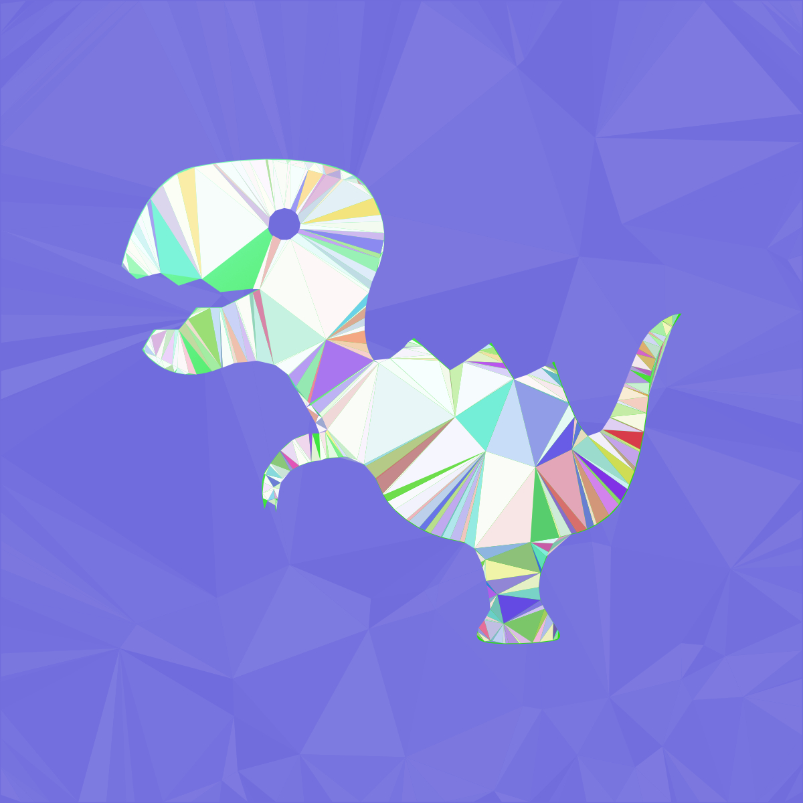

**English** | [Deutsch](README.de.md)

# 🦖 TrianRex

> **Triangulation for Affinity Designer** — turn any vector object into an
> individual mesh of triangles to create your own polygon-art.

  

---

## 📥 Download

⬇️ **[Download TrianRex v0.9.8](downloads/TrianRex_v0.9.8.afscript)**
⬇️ **[Download TrianRex v0.9](downloads/TrianRex_v0.9.afscript)**

## ✨ Features

| Feature | Description |
|---------|-------------|
| 🎯 **Contour-accurate triangulation** | The triangles follow the object's exact outer contour — circles, stars, hearts or custom paths stay clearly recognizable |
| 🎨 **Object color** | The original's fill (solid colors **and** gradients) is transferred onto the triangles |
| 🎲 **Random mode** | Colorful variations of the object color, starting from the nearest hues |
| ↕️ **Gradient modes** | Directional shadings: top→bottom, bottom→top, left→right |
| 🌈 **Color variation** | Slider for subtle to strong per-triangle color shades |
| ⚙️ **Adjustable size & irregularity** | Triangle size and point grid jitter are freely configurable |
| 🎲 **Seed** | Same seed = reproducible result |
| 📁 **Automatic grouping** | The result lands in its own group (`Object-Triangulated`, `-1`, `-2`, …) |

## 🚀 Installation

1. Download: [`downloads/TrianRex_v0.9.8.afscript`](downloads/TrianRex_v0.9.8.afscript)
   - If you cant see the file, simply klick on the download arrow in the right corner or on "view file"
2. Place the file into your Affinity scripts folder
   *(in Affinity Designer, found under: **Edit → Preferences → Tools → Scripts** or Import Script via Scriptlibrary)*
3. Restart Affinity Designer
4. Run the script via the Scripts console or script menu

## 📖 Usage

1. Select any vector object (shape or curve)
2. Run the `TrianRex` script
3. Adjust the parameters in the dialog
4. Click **OK** — the triangle group is created ✅

> 💡 **Tip:** The original object stays untouched — simply hide it to
> view only the triangulation result.

## ⚠️ Known Limitations (Beta)

- On very complex shapes, gradients are not always detected correctly
- Occasionally, small edge triangles may stick out minimally beyond the contour
- Sometimes Affinity serves cached object data — if in doubt, save, re-open your projekt and re-run the script

## 🛠️ Technology

- **Platform:** Affinity Designer 3 (scripting API)
- **Language:** JavaScript (`.afscript`)
- **Geometry:** Custom Delaunay triangulation with shape filtering (ray casting + edge tests)

## 🤖 AI-Assisted

This script was developed with the help of **AI assistance**
(iterative debugging together with tester feedback ❤️).

Found a bug? Got feedback? Feel free to open an issue!

## 🦊 Personal Note

I'm a big believer in scripting my own stuff — but since I don't have much
time for this side quest, I built it 99% with an LLM (AI).

Since it's JS, though, I can work with it and am happy to help with questions.
You can load the script manually into Affinity, or simply install one of the packaged versions.

Cheers

---

*Made with 🦊 and AI 🐾*